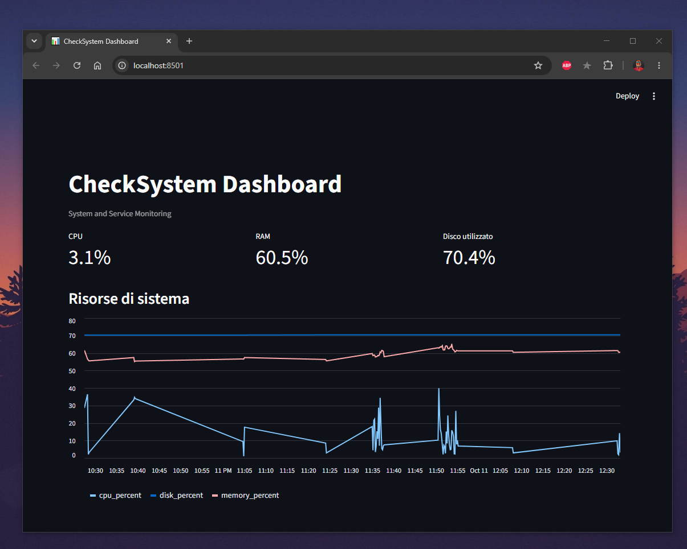

# CheckSystem

**CheckSystem** è un sistema di monitoraggio delle risorse di sistema e della disponibilità dei servizi web, sviluppato in Python.

Il progetto raccoglie metriche, registra lo storico in un database SQLite e genera avvisi quando vengono superate determinate soglie. Una dashboard interattiva consente di consultare le metriche e gli eventi registrati.

Il progetto nasce con l'obiettivo di approfondire lo sviluppo Python, la gestione dei database, i test automatici e il monitoraggio dei sistemi.


## Dashboard

La dashboard interattiva consente di monitorare le risorse del sistema,
consultare le metriche raccolte e analizzare lo storico degli eventi.




## Funzionalità

- **Monitoraggio del sistema:** rilevamento dell'utilizzo di CPU, memoria RAM e disco.
- **Controllo dei servizi web:** verifica della raggiungibilità di URL configurati.
- **Soglie configurabili:** definizione dei limiti per le metriche monitorate tramite `config.json`.
- **Gestione degli avvisi:** rilevamento dei superamenti delle soglie e registrazione degli eventi di ripristino.
- **Notifiche Telegram:** invio di notifiche per gli eventi di allarme e ripristino.
- **Database SQLite:** archiviazione delle metriche e dello storico degli eventi.
- **Dashboard interattiva:** visualizzazione dei dati tramite Streamlit.
- **Logging:** registrazione delle informazioni operative e degli errori.
- **Test automatici:** verifiche con pytest per le funzionalità principali.

## Tecnologie utilizzate

- Python
- SQLite
- Streamlit
- pandas
- psutil
- requests
- python-dotenv
- pytest
- Git e GitHub

## Requisiti

- Python 3.10 o superiore
- pip
- Connessione Internet per il controllo dei servizi web e le notifiche Telegram

## Installazione

Clona il repository:

```bash
git clone https://github.com/alexmocci/CheckSystem.git
cd CheckSystem
```

Crea e attiva un ambiente virtuale.

**Windows (PowerShell):**

```powershell
python -m venv .venv
.\.venv\Scripts\Activate.ps1
```

Installa le dipendenze:

```bash
pip install -r requirements.txt
```

## Configurazione

Modifica `config.json` per personalizzare l'intervallo di monitoraggio, il percorso del disco, i servizi web da controllare e le soglie di allarme.

Esempio della struttura di configurazione:

```json
{
  "interval_seconds": 10,
  "disk_path": "C:\\",
  "services": [
    {
      "name": "Example Website",
      "url": "https://example.com"
    }
  ],
  "thresholds": {
    "cpu_percent": 85,
    "memory_percent": 90,
    "disk_percent": 90
  }
}
```

Per abilitare le notifiche Telegram, configura le variabili d'ambiente `TELEGRAM_BOT_TOKEN` e `TELEGRAM_CHAT_ID` nel file `.env`, senza pubblicare tale file su GitHub.

## Utilizzo

Avvia il monitoraggio:

```bash
python main.py
```

Avvia la dashboard in un secondo terminale:

```bash
streamlit run dashboard.py
```

Esegui i test automatici:

```bash
pytest -v
```

Consulta lo storico degli eventi tramite le funzionalità disponibili in `history.py`.

## Struttura del progetto

```text
CheckSystem/
├── alerts.py
├── check_config.py
├── config.json
├── dashboard.py
├── database.py
├── history.py
├── logging_config.py
├── main.py
├── notifications.py
├── requirements.txt
└── tests/
    ├── test_alerts.py
    └── test_database.py
```

## Obiettivi di sviluppo

CheckSystem è un progetto personale in evoluzione, sviluppato per consolidare competenze pratiche in:

- programmazione Python e organizzazione del codice;
- persistenza dei dati tramite database relazionali;
- monitoraggio e gestione degli eventi;
- test automatici e debugging;
- integrazione con servizi esterni tramite API;
- sviluppo di interfacce per la visualizzazione dei dati;
- controllo versione tramite Git.

## Autore

**Alessandro Mocci**

GitHub: [@alexmocci](https://github.com/alexmocci)
